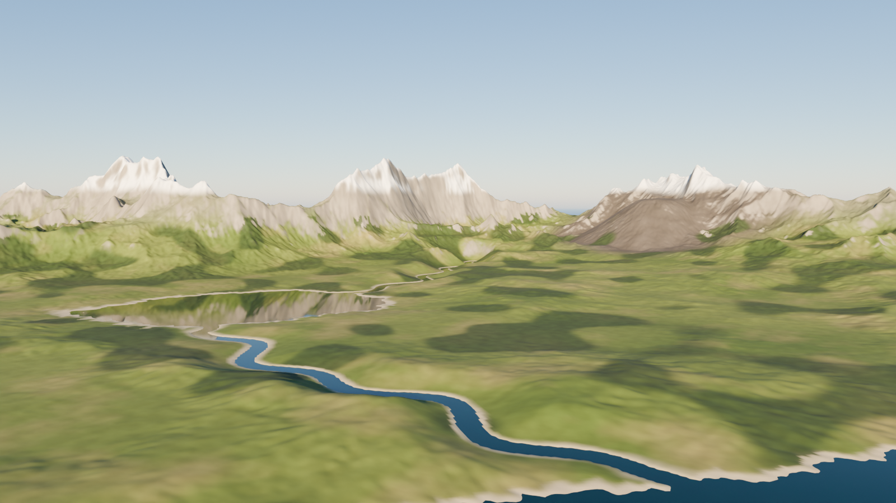
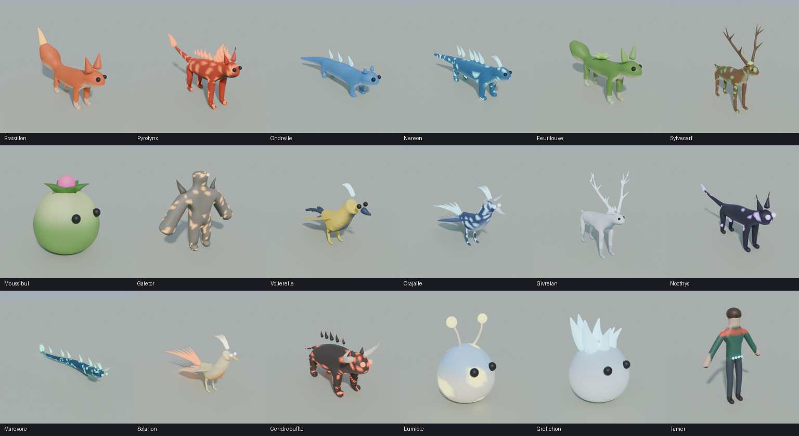

# AETHERWILD

Jeu PC en monde ouvert pour **Unreal Engine 5** (C++), avec des assets générés dans **Blender**.
Tu explores une île-continent de 8 km × 8 km (plaines, forêts, lac, rivière, océan, montagnes enneigées, volcan) peuplée de
**17 espèces de créatures**. Tu peux les **capturer** dans des micro-capsules, les garder **dans ta poche** (6 max) ou au
**Sanctuaire** (stockage illimité), les **faire combattre**, les **chevaucher** (sur terre, sur l'eau ou dans les airs) et
les faire **évoluer**.

*Aperçu Blender du terrain généré : ce n'est pas un rendu Unreal, il sert à montrer la carte.*

---

## ▶ Construire le jeu en un clic (Aetherwild.exe)

1. Installe **Unreal Engine 5.6** (Epic Games Launcher) et **Visual Studio 2022** avec la charge de travail
   « Développement de jeux en C++ ».
2. *(Facultatif)* Pour avoir Rampage : dans Unreal, *Window > Fab* > « Paragon: Rampage » > **Add to Project**.
3. **Double-clique `BUILD_GAME.bat`.** Le script s'occupe de tout :
   - compilation du code ;
   - création du niveau et import automatique du terrain de 8 km ;
   - matériaux, modèles, ciel, eau, végétation v2 et créatures ;
   - packaging.
4. Le jeu se trouve dans **`Build\Windows\Aetherwild.exe`**. Le premier passage prend 1 à 3 heures, surtout pour la
   compilation des shaders.

En cas d'erreur, le journal complet est dans `Saved\BUILD_GAME.log`. Les étapes de préparation du monde sont détaillées dans
`Saved\build_all_status.txt`.

## 1. Ce qui est fourni

| Dossier | Contenu |
|---|---|
| `Source/Aetherwild/` | Tout le gameplay en C++ (16 classes, ~6 300 lignes) |
| `Content/Data/*.json` | Espèces, capacités, monde et végétation : **modifiables sans recompiler** |
| `Art/Creatures/`, `Art/Characters/` | 17 créatures + le dresseur en FBX : maillage, squelette, animations (Idle, Walk, Run, Attack, Fly, Swim, Throw, Ride) |
| `Art/Environment/` | Rochers, falaises, arbres (feuillus, conifères), buissons, herbe, fleurs, sanctuaire (FBX, importés en Nanite) |
| `Art/Terrain/` | Heightmap 16 bits 4033² (8 km, érosion hydraulique) + version légère 2017² |
| `Tools/Blender/generate_assets.py` | Régénère tous les modèles 3D (procédural, déterministe) |
| `Tools/Terrain/generate_terrain.py` | Régénère le terrain, les biomes et les points d'apparition (`--seed` pour une autre île) |
| `Tools/Unreal/setup_aetherwild.py` | Installation automatique dans l'éditeur (matériaux, import, ciel, eau, post-process) |
| `Tools/Unreal/use_realistic_assets.py` | Branche automatiquement les packs Megascans/Fab : terrain texturé, arbres, herbes, rochers |
| `Docs/Direction_Artistique.md` | Fiches de design réalistes des 17 créatures et du dresseur, avec prompts |
| `Config/` | Rendu nouvelle génération pré-réglé (Lumen, Nanite, ombres virtuelles, ray tracing, TSR, DX12/SM6) |

## 2. Prérequis

- **Unreal Engine 5.6** (5.4+ devrait fonctionner : change `EngineAssociation` dans `Aetherwild.uproject` si besoin)
- **Visual Studio 2022** avec la charge de travail « Développement de jeux en C++ » (+ composant « Unreal Engine installer »)
- Carte graphique **DirectX 12** ; une RTX (ou RX 6000+) est recommandée pour le ray tracing matériel de Lumen
- 16 Go de RAM minimum (32 Go conseillés pour l'éditeur avec un terrain de 8 km)

## 3. Installation (environ 20 minutes, une seule fois)

1. **Compiler** : double-clique sur `Aetherwild.uproject` et réponds **Oui** à « Rebuild modules ».
   Si ça échoue : clic droit sur `Aetherwild.uproject` > *Generate Visual Studio project files*, ouvre `Aetherwild.sln`,
   choisis la configuration **Development Editor** et lance **Build**. Le message d'erreur exact apparaît dans la fenêtre *Output*.
2. **Créer le niveau** : *File > New Level > Empty Open World* (ou *Empty Level*), puis *File > Save Current Level As…*
   dans `Content/Aetherwild/Maps/L_Aetherwild`.
3. **Importer le terrain** : mode *Landscape* (Maj+2) > *Manage* > *Import from File*
   - Heightmap : `Art/Terrain/Aetherwild_Heightmap_4033.png`
   - Section Size **63×63 quads**, Sections Per Component **2×2**, Number of Components **32×32** (résolution 4033×4033)
   - **Location** X = `-403200`, Y = `-403200`, Z = `43200`
   - **Scale** X = `200`, Y = `200`, Z = `200`
   - Clique sur **Import**. Ensuite, dans les *Details* du Landscape : coche **Nanite > Enable Nanite** puis *Build Data*.

   *PC modeste :* `Aetherwild_Heightmap_2017.png`, composants 16×16, scale X/Y = `400` (même taille de carte, moins de détails).
   Toutes ces valeurs sont aussi dans `Content/Data/world.json`.
4. **Lancer l'installation automatique** : *Tools > Execute Python Script…* > `Tools/Unreal/setup_aetherwild.py`.
   Le script crée les matériaux, importe les 31 FBX, règle soleil, lune, ciel, nuages, brouillard volumétrique,
   post-process et océan, puis sauvegarde le niveau. Il peut être relancé sans rien dupliquer.
5. **Jouer** : bouton *Play* (Alt+P). Pour le meilleur rendu : *Settings > Engine Scalability* sur **Epic** ou **Cinematic**.
6. **Créer l'exécutable** : *Platforms > Windows > Package Project*.

> Le jeu fonctionne aussi **sans l'étape 4** : il génère alors un ciel, un soleil et un océan de secours, et les créatures
> apparaissent sous forme de sphères colorées. C'est pratique pour vérifier que tout compile.

## 3 bis. Carte « v2 » : la direction artistique des rendus dans le jeu

Les rendus de `Docs/previews/map/` (prairie, forêt, cimes, volcan, côte, vue aérienne) définissent le style de la carte. Leurs
assets sont exportés pour Unreal dans `Art/EnvironmentV2/` :
- arbres feuillus, cerisiers et automnaux, avec des milliers de feuilles ;
- sapins, arbres morts ;
- herbes, fleurs, fougères ;
- rochers moussus, basalte ;
- coulées de lave tracées sur le vrai relief du volcan.

Pour les appliquer :
1. Après l'étape 4, lance *Tools > Execute Python Script* > `Tools/Unreal/apply_world_v2.py`. Le script :
   - importe ces assets et leurs textures ;
   - crée le feuillage translucide au vent (`M_LeafV2`) et la lave craquelée animée (`M_Lava`) ;
   - place les coulées de lave ;
   - active `Content/Data/scatter_v2.json` : 13 couches de végétation réparties par biome sur les 8 km de la carte.
2. En jeu, le brouillard et sa teinte s'adaptent au biome où tu te trouves : bleu doré en prairie, vert doré en forêt,
   froid en altitude, rougeoyant près du volcan.

Pour régénérer ces assets : `python Tools/Blender/export_world_assets.py`. Pour refaire les rendus :
`python Tools/Blender/concept_world.py --scene prairie|foret|cimes|volcan|cote|ile --res 1440`.

## 4. Commandes

| Touche (AZERTY / QWERTY) | Action |
|---|---|
| ZQSD / WASD, souris | Se déplacer, caméra |
| Maj | Sprint (ou galop sur une monture) |
| C | Discrétion : les créatures craintives te remarquent moins |
| Espace / Ctrl | Sauter ; s'envoler, monter et descendre sur une monture volante |
| **Clic droit maintenu** | Viser |
| **Clic gauche** | En visée (ou sans compagnon) : **lancer une capsule**. Sinon : ordonner au compagnon d'attaquer la cible visée |
| 1 2 3 4 (& é " ') | Ordonner une capacité précise |
| R | **Coup spécial** (quand la jauge de Résonance est pleine) |
| Tab | Verrouiller ou changer de cible |
| G | Sortir ou rentrer la créature sélectionnée |
| Molette | Choisir une créature dans la poche |
| E | Chevaucher ou descendre |
| T | Changer de capsule (Micro, Ultra, Prisme) |
| H | Potion |
| F | Sanctuaire : soins, recharge de capsules, sauvegarde, point de réapparition |
| B | Écran **Sanctuaire** : poche, stockage et **Bestiaire** |
| F1 | Aide • F5 / F9 : sauvegarder / charger |

La manette Xbox ou PlayStation est aussi prise en charge.

## 5. Systèmes de jeu

**Capture.** Affaiblis la créature, inflige-lui si possible un statut (Sommeil et Gel doublent les chances), puis lance une
capsule. La capsule l'absorbe et **secoue 3 fois** : chaque secousse peut échouer. La chance dépend :
- de la **rareté** (Commun 55 % de base… Légendaire 4 %) et du **niveau** de la créature par rapport à ton niveau de dresseur ;
- des **PV restants** et du **statut** ;
- de la **capsule** : Micro ×1, Ultra ×1,8, Prisme ×3,5 (quasi garantie, sauf sur les légendaires) ;
- d'une résistance qui augmente à chaque évasion.

Certaines espèces ont des **conditions spéciales** : heure du jour, météo, élément de la dernière attaque subie, PV sous un
seuil, niveau de dresseur, statut obligatoire. La fiche de la cible (en haut de l'écran) affiche soit la **chance exacte**,
soit **la condition manquante**.

**Combat en temps réel.** Ton compagnon te suit, te défend automatiquement et exécute tes ordres. Chaque créature a jusqu'à
4 capacités, en 6 formes : corps-à-corps, projectile à tête chercheuse, onde de zone, charge, renforcement, soin. Elles se
répartissent entre **9 éléments**, avec une table d'efficacité (×2 / ×½), un bonus quand l'élément de la capacité est celui
de la créature (×1,25), des coups critiques, de la précision et **7 altérations d'état** (Brûlure, Trempé, Enraciné,
Étourdi, Gelé, Aveuglé, Endormi). Les coups donnés et reçus remplissent la **Résonance**, qui débloque le **coup spécial**.

**Progression.** Les compagnons gagnent de l'XP, montent de niveau, apprennent de nouvelles capacités et **se métamorphosent**
(Braisillon → Pyrolynx, Ondrelle → Néréon, Feuillouve → Sylvecerf, Grelichon → Givrelan, Volterelle → Orajaile). Ton
**niveau de dresseur** augmente avec les captures et les victoires, et débloque des capsules ainsi que les créatures
exigeantes. Il existe aussi des **variantes prismatiques** (1 chance sur 512, statistiques légèrement supérieures).

**Montures.** Toute créature marquée « Monture » peut être chevauchée avec E : au sol (Pyrolynx, Sylvecerf, Givrelan,
Cendrebuffle), sur l'eau (Néréon, Marévore) ou **en vol** (Orajaile, Solarion). Tu peux attaquer depuis ta monture.

**Monde vivant.** Cycle jour/nuit de 32 minutes, avec soleil et lune ; météo dynamique (dégagé, nuageux, pluie, orage,
brouillard, neige) qui modifie le brouillard et la lumière. Les créatures dépendent du biome, de l'heure et de la météo :
Nocthys et Lumiole sortent la nuit, Orajaile pendant les orages, Solarion au crépuscule. Elles ont aussi un **tempérament**
(docile, craintif, territorial, agressif). Tu peux nager partout. 144 zones d'apparition et 10 sanctuaires sont placés
automatiquement selon les biomes, et la végétation pousse en continu autour de toi.

## 6. Bestiaire

| Créature | Élément | Rareté | Biome | Particularités |
|---|---|---|---|---|
| Braisillon | Feu | Commun | Plaines, volcan | Starter ; éclaire la nuit |
| Pyrolynx | Feu | Rare | Volcan, montagnes | Monture ; doit être affaibli par l'Eau |
| Ondrelle | Eau | Commun | Rivages | Starter ; amphibie |
| Néréon | Eau | Rare | Rivages, lac | Monture aquatique ; capture à l'aube ou au crépuscule |
| Feuillouve | Nature | Commun | Forêts, plaines | Starter |
| Sylvecerf | Nature | Rare | Forêts | Monture rapide ; doit subir un statut |
| Moussibul | Nature | Commun | Plaines, forêts | Endort avec ses spores |
| Galetor | Roche | Peu commun | Montagnes | Golem ; dresseur niveau 3 |
| Volterelle | Foudre | Peu commun | Plaines, côtes | Vole |
| Orajaile | Foudre | Épique | Montagnes | Monture volante ; uniquement pendant les orages |
| Grelichon | Givre | Commun | Sommets | Évolue en Givrelan |
| Givrelan | Givre | Rare | Sommets | Monture ; doit être affaibli par le Feu |
| Nocthys | Ombre | Rare | Forêts (nuit) | Capture de nuit uniquement |
| Cendrebuffle | Feu/Roche | Peu commun | Volcan | Monture ; agressif |
| Lumiole | Lumière | Commun | Plaines (nuit) | Lanterne vivante |
| **Marévore** | Eau/Ombre | **Légendaire** | Lac / océan | Serpent de 14 m ; pluie, PV < 25 %, dresseur niveau 15 |
| **Solarion** | Lumière/Feu | **Légendaire** | Sommets, volcan | Oiseau-soleil ; crépuscule, attaque d'Ombre, PV < 20 %, dresseur niveau 20 |

## 7. Personnaliser

- **Ajouter ou équilibrer des créatures** : `Content/Data/species.json` (statistiques, biomes, conditions de capture,
  évolutions…) et `abilities.json`. Pas besoin de recompiler : relance simplement le jeu.
- **Nouveaux modèles** : ajoute une entrée dans `CREATURES` de `Tools/Blender/generate_assets.py` (archétypes quadrupède,
  bipède, avien, serpent, blob), puis lance `blender -b -P Tools/Blender/generate_assets.py -- --only MaCreature` et relance
  le script Unreal. Tu peux aussi remplacer n'importe quel FBX par un modèle fait main : il suffit qu'il soit dans
  `/Game/Aetherwild/Creatures/<Id>/` et que ses animations se terminent par `Idle`, `Walk`, `Run`, `Attack`, `Fly` ou `Swim`.
- **Autre île** : `python Tools/Terrain/generate_terrain.py --seed 42`, puis réimporte la heightmap.

## 8. Passer au rendu photoréaliste (niveau AAA)

**Ce qui limite le réalisme aujourd'hui, ce sont les modèles, pas le moteur.** Le rendu est déjà réglé au maximum :
Lumen avec ray tracing matériel, Nanite, ombres virtuelles, TSR, ciel et nuages volumétriques, eau *Single Layer
Water*, et 1440p en qualité Épique par défaut (`Config/DefaultGameUserSettings.ini`). Le jeu s'affiche à la résolution
native de ton écran. Les petites images du dossier `Docs/previews` ne sont que des aperçus Blender basse résolution.

Les créatures et le dresseur générés par code sont des **maquettes stylisées jouables**. Un rendu « open world 2026 » demande des
assets sculptés, texturés et animés par des artistes, ou issus de scans. Le projet est prévu pour les remplacer
**sans modifier le code** :

### a) Environnement photoréaliste (environ 1 heure)
1. Dans l'éditeur, *Window > Fab* : ajoute des **surfaces** Megascans (herbe, roche, neige, sable, sol volcanique) et
   des **plantes et rochers 3D** (arbres feuillus et conifères, buissons, herbes, fleurs, blocs, falaises), de préférence
   en version Nanite.
2. *Tools > Execute Python Script* > `Tools/Unreal/use_realistic_assets.py`.
   Le script détecte les assets et crée **M_LandscapeRealistic** (vraies textures mélangées selon l'altitude, la pente et
   le volcan, avec normales, rugosité, AO et anti-répétition). Il l'applique au terrain, puis remplace les arbres, herbes
   et rochers dans `Content/Data/scatter.json` (l'ancien fichier est conservé dans `scatter.stylise.json`).
3. Pour un océan avec de vraies vagues 3D et de l'écume, remplace `Aether_Ocean` par un *Water Body Ocean* (plugin Water,
   déjà activé).

### a bis) Ajouter des créatures d'un pack Fab (automatique)
1. Dans l'éditeur, ouvre *Window > Fab*, puis sur la page du pack : **Add to My Library**, puis **Add to Project**.
2. *Tools > Execute Python Script* > `Tools/Unreal/import_fab_creatures.py`.
   Pour chaque créature du pack (SkeletalMesh), le script retrouve ses animations (Idle, Walk, Run, Attack, Fly, Swim) et
   déduit son élément, sa rareté, ses biomes, ses statistiques, ses capacités et si elle peut servir de monture. Il
   l'ajoute ensuite à `Content/Data/species.json` (une copie de l'original est gardée dans `species.backup.json`) et
   écrit un rapport dans `Saved/Aetherwild_import_report.txt`.
3. Appuie sur *Play* : les créatures apparaissent dans le monde, peuvent être capturées, combattent et se chevauchent.
   Les noms, les statistiques et les conditions de capture restent modifiables dans `species.json`.

### b) Dresseur photoréaliste : MetaHuman
1. Crée ton personnage avec **MetaHuman Creator** (intégré à l'éditeur depuis UE 5.6) et ajoute-le au projet.
2. Crée un Blueprint enfant de **AetherPlayerCharacter** (`BP_Tamer`). Dans *Mesh*, mets le corps du MetaHuman ;
   ajoute visage, cheveux et vêtements en composants enfants (*Leader Pose Component* = Mesh).
3. Choisis un **Animation Blueprint** dont la classe parente est `AetherAnimInstance` (variables prêtes : Speed, Gait,
   Direction, bIsInAir, bIsSwimming, bIsRiding, bIsAiming…). Mets-y un *Blend Space* Idle/Walk/Run et un nœud **Slot
   « DefaultSlot »** pour le lancer de capsule. Les animations du *Game Animation Sample* d'Epic (gratuit) conviennent.
4. Dans `species.json` > `"player"` : `"blueprint": "/Game/Characters/BP_Tamer"` et `"anims": {"Throw": "..."}`.

### c) Créatures réalistes
- **Fiches de design** de chaque créature et du dresseur, avec références anatomiques, matériaux et prompts pour
  générateurs 3D : `Docs/Direction_Artistique.md`. Elles sont à remettre à un artiste 3D ou à utiliser avec des packs Fab
  ou un générateur 3D par IA.
- Branchement, deux options au choix :
  - **simple** : bloc `"visual"` dans `species.json` (`mesh`, `animBlueprint`, `anims`, `yaw`, `saddleSocket`) ;
  - **complet** : Blueprint enfant de **Creature** (fourrure Groom, matériaux, effets Niagara, AnimBP), puis
    `"visual": {"blueprint": "/Game/Creatures/Loup/BP_Loup"}`. Le jeu l'utilise pour les apparitions sauvages et les
    compagnons.
- Avec un Animation Blueprint (parent `AetherAnimInstance`), la locomotion devient **fluide** (blend spaces, transitions,
  regard vers la cible avec `LookYaw`). Les attaques sont jouées en montage sur le slot « DefaultSlot ».
- Les animations dont le squelette ne correspond pas au modèle sont ignorées automatiquement.

### d) Finitions
- Effets Niagara de pluie, neige, braises et souffle froid, à déclencher depuis `UAetherWorldSubsystem::ApplyLighting`.
- Reflets *hit lighting* : `r.Lumen.HardwareRayTracing.LightingMode=2` (RTX 4070 ou mieux).
- Interface en UMG, sons et musique d'ambiance.

## 9. Architecture du code

| Classe | Rôle |
|---|---|
| `UCreatureDatabase` | Charge les JSON, tire les apparitions (biome, heure, météo, rareté), retrouve les modèles et animations |
| `UAetherWorldSubsystem` | Heure, météo, soleil, lune et brouillard |
| `ACreature` | IA sauvage et compagnon, combat, statuts, nage et vol, monture, XP et évolution |
| `AAbilityProjectile`, `AAetherVfx` | Projectiles et effets lumineux des capacités |
| `ACaptureCapsule` | Lancer, absorption, 3 secousses, calcul et conditions de capture |
| `UCreatureCollectionComponent` | Poche (6), stockage, capsules, potions, pièces, Bestiaire, niveau de dresseur |
| `AAetherPlayerCharacter` | Le dresseur : déplacement, nage, visée, ordres, monture, PV, sanctuaires, sauvegarde |
| `AAetherPlayerController` | Contrôles Enhanced Input créés en C++ (clavier AZERTY/QWERTY + manette) |
| `AAetherHUD` | Toute l'interface, dessinée en Canvas (aucun widget à créer) |
| `UAetherAnimInstance` | Classe parente des Animation Blueprints (MetaHuman, créatures réalistes) |
| `ACreatureSpawner`, `AAetherShrine`, `AWorldScatter` | Zones d'apparition, sanctuaires, végétation streamée en instances (HISM) |
| `AAetherGameMode` | Place le contenu du monde au lancement à partir de `world.json` |

## 10. Limites actuelles

- Le code C++ a été écrit et vérifié statiquement, mais **pas encore compilé dans Unreal** (l'environnement de génération
  n'avait ni Unreal ni GPU). La première compilation peut demander quelques petites corrections d'API selon ta version
  d'UE : envoie le journal d'erreurs et elles se corrigent en quelques minutes.
- Les animations passent d'un cycle à l'autre sans fondu ; l'étape suivante serait un *Animation Blueprint* avec
  *Blend Space*.
- L'interface est en Canvas (fonctionnelle, mais sobre) ; elle peut être refaite en UMG pour un rendu plus soigné.
- La nage repose sur un niveau de mer unique, que partagent le lac, la rivière et l'océan.
